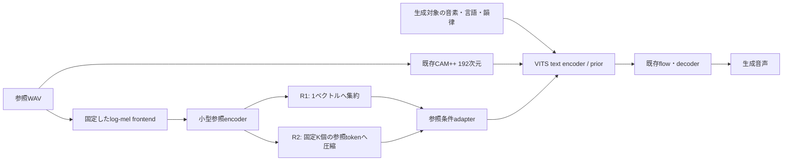

# GPT-SoVITSの知見を取り込むZero-Shot改善実験計画

作成日: 2026-10-17。状態: **計画作成。新しい参照音響構造の実装・GPU学習は未実施**。
作成時のPiperソース: `638b18f5558d4421c6614de7531b0c8cb4cc4be8`。
対象ブランチ: `feat/zero-shot-v8-dataset-scaling`。

本書は、この実験の背景、実装範囲、学習方法、工程、評価、費用、完了条件をまとめた
独立した実施計画書である。過去の会話を前提にせず読めるよう、開始時点の状況と用語も記す。
末尾の関連文書・コードへのリンクは、根拠と詳細仕様を確認するための参照先とする。

## 1. 目的と実施順序

GPT-SoVITSが使う参照音響情報の経路をPiper向けに実装し、未知話者の声の再現性を
改善できるかをCloudRiftの最大$1000のクレジットで検証する。
優先順位は **採用範囲・契約確定 → 実装・CPU検証とデータ復元 → GPU比較学習 → 評価**。
現行構造だけの長い継続学習を先に実行する計画を、本書で置き換える。

既存のCPU評価、入力監査、G/D更新修正、保存・再開・監視の整備は再利用する。
それらの完了を、GPT-SoVITS由来の新構造の実装完了や品質改善と呼ばない。
今回は計画文書のみを追加し、学習コード変更、レンタル、起動、push、モデル公開は行わない。

成功の対象は、日本語を中心とする未知話者の類似度と、読み・自然さ・ノイズの両立。
英語・中国語を初期の多言語退行確認に使い、残りの対応言語も最終確認へ含める。
つくよみちゃんへの特化学習は、この汎用Zero-Shot改善とは別の実験として扱う。

### 1.1 背景と学習方法

Piperの現行経路は、参照音声をCAM++の192次元の話者特徴へまとめ、音声生成へ渡す。
このglobal特徴に加え、参照音声の音響情報を別経路で渡すことで、声質の再現性が
改善するかを調べる。追加する音響encoderと条件付けは未学習なので、実装後に学習が必要となる。

学習は、既存モデルと互換な部分の重みを引き継ぎ、新規部分を初期化する方式を第一候補とする。
以前のoptimizerやEMA履歴をそのまま復元する方式とは区別する。既存重みの利用可否は、
共通moduleの形状・意味・入出力が一致するかを検査して決める。

したがって、最初の作業は新経路の仕様と実装である。現行モデルだけの継続学習は、
新経路による効果を比較するための対照群に位置付ける。

### 1.2 用語

| 用語 | 本書での意味 |
|---|---|
| Zero-Shot / 未知話者 | 話者専用の追加学習なしで参照音声から声を再現すること。未知話者の認定には過去の学習集合も確認する |
| reference / target | 声の条件を得る参照音声 / 生成・学習の対象となる発話。同じ話者の別発話を使う |
| global話者特徴 | 参照全体を1本にまとめた話者vector。既存のCAM++経路が該当する |
| 参照音響token | 小型encoderが実音声の音響系列から圧縮した複数の特徴。文字や音素tokenとは別のもの |
| prior | 音素・話者条件から、音声生成に使う潜在表現の分布を予測する部分 |
| raw / EMA | 保存された通常のモデル重み / 学習中の重みの指数移動平均。評価では区別する |
| CER | 文字誤り率。生成音声をASRで認識し、指定textとの編集距離を測る。反復・挿入によって1を超える場合もある |
| cross-utterance類似度 | 生成音声と、参照として使用しなかった同一話者の実発話との類似度 |
| smoke / pilot | 学習・保存・再開などの動作確認 / 条件を絞るための短期比較。完成モデルの品質承認とは分ける |
| manifest | 使用ファイル、hash、分割、参照ペア、条件などを固定して記録した一覧 |

## 2. 確認済みの開始点

| 項目 | 2026-10-17の確認結果 | 計画への意味 |
|---|---|---|
| 上流main | `1b47ca07ef43a284e0b8bd7f29d3e1e3ff76082a`、2026-10-08 commit。GitHub APIで再照会 | 出典をこのSHAへ固定。実装開始時に差分を再確認 |
| 上流latest正式release | `20250606v2pro`。GitHub APIで再照会 | V2Pro正式版とV5開発実装を区別 |
| V2Pro | `MelStyleEncoder`の参照特徴と話者特徴`sv_emb`を併用 | 小型の音響参照経路を追加する根拠 |
| V5 | `reference_features`と`reference_mel`を生成へ渡す | 情報経路を参考にする。Piperに同じ改善量が出るという根拠ではない |
| Piper | CAM++ global条件はあるが、新しい参照音響encoder・token経路は未実装 | GPU本学習より先に実装する |
| CPU基準評価 | v10b ep79 / v11 ep9 / ep19、raw・EMA・fresh ONNXを実測 | 固定した旧結果を保持。新しい実験は別manifest・別出力にする |
| 品質の開始点 | 今回の1話者・3文ではv10bが良好、v11の改善は支持されない | v10b ep79を既存重みの候補にする。全話者で最良とは認定しない |
| 学習データ | `training_ready=false`。音声・spec等未配置、embedding来歴未認証 | GPU開始前に、選択した学習集合を復元・監査する |
| CloudRift | 残高$1000相当、照会範囲の稼働instance 0 | 未使用枠を段階的に配分する |
| GPU候補 | `rtx59-7-24-800-ig.1`、RTX 5090×1、VRAM 32GiB、RAM 24GiB、disk 800GiB、$0.65/instance時 | 単GPUで開始。RAM・ディスク・速度の実測が必要 |
| 在庫・保存 | 韓国、空きnode数目安13。専用public IPなし、volume種類の提示なし | 起動直前に再照会。共有IPのSSHを確認。外部回収を前提にする |

CloudRiftの在庫は予約済みの台数ではない。価格・構成・クレジット対象範囲と有効期限は
起動直前に確認する。ローカルのAPI照会記録は
`output/cloudrift-readonly-audit-20261017/assessment.json`。キーは記録・転送しない。

### 2.1 保存済みの品質評価と限界

以下は2026-10-17に行った、つくよみちゃん1話者・固定3文のCPU評価からの抜粋。
CAM++/ECAPAの値は、使用した参照音声を除外した別発話との平均cosineである。

| モデル | 評価重み | CER中央値 | CAM++ cross | ECAPA cross |
|---|---|---:|---:|---:|
| v10b ep79 | raw | 0.1905 | 0.7205 | 0.5999 |
| v10b ep79 | EMA | 0.0952 | 0.7165 | 0.5998 |
| v11 ep9 | EMA | 1.3810 | 0.6404 | 0.3959 |
| v11 ep19 | EMA | 1.1905 | 0.5608 | 0.3241 |

この小規模評価から、次の重み移行の候補をv10b ep79にする。全話者・全言語で最良と判断したものではない。
rawを新runの開始重みとして固定し、EMAは別の推論評価対象とする。
旧評価の限られた話者数・floor候補数を補うため、本計画では評価集合を拡張する。

## 3. 採用候補と優先度

| 施策 | 初期実験での扱い | 完了の証拠 |
|---|---|---|
| global話者特徴 + 参照音響特徴 | 最優先。以下のR1/R2を実装 | 実WAVから生成した特徴が学習・Torch推論・ONNX・対象runtimeへ接続される |
| 別発話の参照と生成対象を組にする | R1/R2と全比較群の共通条件 | 話者・発話・音声hashとsampling seedを記録。自己参照fallback 0 |
| 参照の無音・clipping・長さ・話者混入の検査 | 全群共通の入力監査 | 判定理由と除外数を保存。未較正の閾値を品質保証として使わない |
| 学習と推論で参照frontendをそろえる | 全群共通 | 実音声のgolden比較、frontend設定/hashの固定 |
| 複数参照 | 先にend-to-end経路を実装。主実験は単一参照で固定し、2参照は副次比較 | 両参照のhash除外、mask、cache、CLIからの実生成 |
| 参照を保持した長文生成 | 同じ参照条件を全chunkで保持。まず症状と退行を測る | 長文のchunk別類似度、読み抜け、参照cache再利用の記録 |
| V5の直前chunk文脈の追加 | 初期学習の変数には混ぜない。症状が残った場合の次の単一要因候補 | 採否と再現手順を施策台帳へ記録 |
| semantic GPT / HuBERT-VQ / CFM / 新vocoder / LoRA / turbo蒸留 | 現VITSの参照経路実験と依存構造が異なる。初期予算の対象にしない | 保留理由を記録。未実装を実装済みと数えない |
| F0経路・carrier・F0込みEMA | 本実験の比較条件へ同時追加しない | 使用checkpointの設定を保持。別の因子として扱う |

採用は「上流コードの丸ごと移植」ではなく、Piperの軽量推論へ適合させた設計とする。
直接再利用するコード・重み・依存がある場合は対象単位で出典・ライセンスを確認する。
上流の秒数・frame数・音素比率の閾値は、異なるsample rateや音素体系へコピーしない。

## 4. 実装する構造の初期案

以下は**設計候補**。形状、容量、CPU実測を工程P0〜P3で確認してから学習条件を固定する。

### 4.1 参照encoderと注入位置

- 参照は実音声由来のlog-mel系列。CAM++ vectorの複製から新しい音響情報を作ったと扱わない。
- sample rate、FFT、hop、mel範囲、対数化、正規化は既存レシピを検査して確定し、frontendの版へ含める。
- 初期候補は80 mel bins、幅64〜128程度の小型Conv encoder、token次元64、R2はK=8。
  幅・Kの総当たりは行わず、CPU上の容量・速度検査で一構成に絞る。
- R1はmasked poolingで1ベクトルに集約。R2は長さmaskを使ってK個へ圧縮する。
  必要な位置情報をencoderへ与える。K tokenが時間と一対一に対応するとは仮定しない。
- 初回の注入点は`TextEncoder`のprior統計量`m_p/logs_p`を作る直前の1箇所。
  text側をqueryとする小型adapterを候補とし、DPへ返す元のhidden表現と分離して実装する。
- decoder・flow・F0への新規注入を同時に追加しない。別の注入点は初期結果を見た次の実験にする。
- 新しい残差の出力projectionをzero-initし、初期状態で既存出力を保つ。
  gateとprojectionの両方をゼロにして勾配経路を閉じない。
- 初期の1 updateでencoder奥の勾配が0になる場合と、恒久的な勾配断線を区別する。
  数update後に参照encoder・adapterの重みが変わることをCPU/GPU両方で検証する。
- 新しい参照encoder・adapterをEMAの対象に明示登録する。既存F0のEMA scopeは別件として保持する。

### 4.2 参照入力・cache・exportの契約

- `reference-encoder.onnx`: 参照melと実長を受け取り、R1 vectorまたはR2 tokenを出す。
- 新TTS ONNX: 従来の話者embeddingに加え、参照tokenとmaskを受け取る別schema。
  旧ONNXの入力を上書きしない。初期案は単一参照K=8、最大2参照分を固定長へpadする。
- 参照melは可変長。3/6/10秒、短い有効入力、最大長、paddingの差をCPU検証し、採用範囲をP0で固定する。
  無音・空入力・非有限値・全maskを黙って有効参照へ変換しない。
- 同じ参照のCAM++と音響tokenを関連付ける。2参照ではCAM++の既存平均規則と、音響tokenの結合/maskを明示する。
- 学習時にも1参照/2参照の条件を固定した規則で与える。2参照経路を検証していない重みには対応を表示しない。
- cache keyには音声hash、crop、frontend版、参照encoder重みhash、mode、K、dtypeを含める。
  学習中のencoderに対し古いtokenを固定cacheとして使わない。学習ではmelのみcacheできる。
- 配布metadataにschema、mode、K、次元、必要graph/hash、対応runtimeを記録する。
- 最初の対応対象はPython学習/Python推論/C++推論。旧モデルの動作を回帰確認する。
  Go/Rust/WASM/C#等の未対応経路は対応状況を監査し、新schemaを明示的に拒否する。
  参照音響を無視して成功したように見せない。全runtime対応済みとは表記しない。

### 4.3 容量とCPUの初期予算案

- 既存schemaのFP16 TTS 40MB、生成CPU p50 +10%以内という既存目標を維持する。
- 新schema案: TTS graph FP16 40MB以内、参照encoder FP16 4MB以内。
  合計44MB以内を**新規の事前登録案**とし、CAM++等の共通配布物を含めた全容量も併記する。
- 同一CPU・thread数・text・参照で、参照cache利用後の生成p50は現行比+10%以内を目標とする。
  p95、実時間係数、peak RSS、cold参照抽出時間と初回音声までの総時間も測る。
- coldとwarmを別々に示し、参照抽出を除いた数値をend-to-end速度として報告しない。
- 新規予算はP3のprototype結果から**GPU学習前に**確定する。達成不能なら小型化・設計変更へ戻る。
  学習後の品質に合わせて旧契約や新規予算を緩和しない。

## 5. データと評価集合

### 5.1 学習集合の復元

1. 初期候補は元の話者IDを保持した6言語の`dataset-gated-speaker-disjoint-candidate.jsonl`、299,728件。
   現在の件数はmetadata上の候補であり、実ファイル監査やペア適格性によって減る可能性を記録する。
2. 原音声、正規化音声、spec、必要なcacheを復元する。v10bの`use_f0_path=False`に不要なF0を強制しない。
3. embeddingの来歴不明分を再抽出し、元WAVからfrontend・encoder・出力hashまで結び付ける。
   sidecarを後付けしただけの認証はしない。
4. 話者名とID、分類器labelの意味、language/symbolの対応を検証する。
   IDが`num_speakers`以上という理由だけで振り直さない。
5. train/validationを固定し、同一話者の参照とtargetは同じsplitから選ぶ。
   同一WAVの別crop、別pathの重複hashも同一音声として扱う。
6. 最低2つの異なる実発話がある話者から、別発話のreference/target pairを作る。
   不適格件数、理由、seed、pair manifestを保存する。targetを参照にするfallbackは0。
7. Gへのglobal CAM++条件も、全比較群で同じ選択referenceから抽出する。
   既存SCL用正例のcache/teacher入力とGのreference条件を別フィールドで管理する。
   R1/R2だけreferenceを別発話へ変えて、構造単独の効果と呼ばない。
8. RAM 24GiB・disk 800GiBに対し、OS/環境、展開時の一時領域、checkpoint、回収待ちを含む容量表を作る。
   不足時は検証済みsubsetへ同じ規則で絞り、全比較群を同じ集合に再固定する。

7言語完全版342,855件への変更、データ増量、ID再配置は別因子として扱う。

### 5.2 未知話者の認定と評価セット拡張

- 既存のつくよみちゃん1話者・3文の結果とmanifestを保持する。
- 拡張セットの初期目標は12話者（日本語8、英語2、中国語2）。各話者に参照候補2発話、
  参照と別の実発話6本以上を確保し、生成textは短文8・長文2を候補にする。
  データの入手・利用許諾・学習履歴を確認できた範囲で確定し、不足を隠さない。
- 開発6話者と最終評価6話者へ話者単位で分割する。各群は日本語4・英語1・中国語1を初期案とする。
  新しい学習のtrain/validation、floor候補、最終評価の役割を固定する。
- **旧checkpointの過去学習集合まで交差を確認できた話者だけを未知話者と認定する。**
  今回のmanifestから除外しただけでは、旧モデルが未学習という証明にならない。
  系統不明の話者は「過去学習履歴不明」として別集計する。
- モデル選択は開発群で行う。最終評価群は条件選択・打ち切り・loss調整へ使用しない。
  最終群を見て再調整した場合は、次の実験で新しい最終群を用意する。
- floorは同言語の別話者から生成結果を見る前に選び、候補数と限界を記録する。
- 単一参照を主条件とし、2参照・参照長・長文chunkの評価は副次条件として分ける。
  言語別の読み上げではなく、話者を保った言語間生成の確認も対応範囲内で含める。

## 6. 比較群と既存重みの使い方

| 群 | 内容 | 判別すること |
|---|---|---|
| E0 | 保存済みv10b ep79、追加学習なし | 現在使えるモデルからの変化 |
| C0 | 現行global-only構造で比較学習 | 共通のデータ復元・参照pair・正しい学習処理だけの効果 |
| Ccap | global-only情報でR1/R2に近い容量のadapterを追加 | パラメータ増加による効果 |
| R1 | global CAM++ + pooled参照音響vector | 新しい音響情報を加える効果 |
| R2 | global CAM++ + K個の参照音響token | pooled参照より複数特徴を渡す効果 |

Ccapはreference音響を受け取らないMLP等で追加学習パラメータ数を近づける。
追加パラメータ数はR1/R2との差±5%以内を初期目標とし、FLOPs・学習速度差も報告する。
完全に容量が一致しなければ、その制限を明記する。E0を学習した対照と取り違えない。

全群で同じ初期checkpoint、学習集合・順序、reference pair、損失・更新周期、評価集合を使う。
R1/R2のencoderをそろえ、pooling/圧縮の差に絞る。追加損失、異なるデータ量、
異なる声質の参照を一緒に変えない。基礎初期化と追加module用のseedを分離する。

### 6.1 重み移行

- 初期候補はv10b ep79 raw weights。旧optimizer/EMA/epoch数は継承しない。
- 共通key・shape・symbol/language/speaker意味を照合し、追加moduleだけを新規初期化する。
  全missing/unexpected keysを保存し、許可した追加module以外の欠落で失敗させる。
  同形状で意味が異なるheadも照合する。`strict=False`を互換性の証明にしない。
- 新規残差を無効化した状態とzero-init初期状態で、固定乱数下の旧モデル出力を確認する。
- 初期の慣らしでは追加module中心の学習を候補とし、続いて共通backboneを同じ規則で学習する。
  凍結範囲・解除条件・optimizer構成・LR比率はP0で固定し、保存・再開の状態に含める。
- 追加moduleの有無が違うため、C0を含む比較では各群の学習対象と慣らし期間を明示する。
  最終的な同条件比較は共通backbone学習開始後の同じデータ露出量で行う。
- 新checkpointからの再開はstrictとし、module、optimizer、EMA、batch clock、pair sampler状態を復元する。
- 重み移行が不成立なら、構造・接続の修正へ戻る。ゼロからの大規模学習を自動で始めない。

## 7. 工程・成果物・次へ進む条件

| 工程 | 作業 | 成果物 | 完了条件 |
|---|---|---|---|
| P0 採用・契約 | 上流との差分台帳、R1/R2仕様、入出力schema、移行表、CPU予算、評価・予算の事前登録 | reference-conditioning仕様、実験spec、採否台帳 | 取り込む内容と比較で固定する条件に未定義がない |
| P1 データ・pair | 実音声復元、来歴、分割、別発話pair、評価話者履歴、容量監査 | 固定manifest、監査JSON、欠損一覧 | 検証済み小subsetで全条件が通る。本走は選んだ全学習集合も監査通過 |
| P2 モデル実装 | frontend、encoder、R1/R2/Ccap、prior注入、train/eval配線、EMA、移行 | モデル・loader・checkpoint実装とTDD回帰 | 旧経路互換、参照で出力が変わる、新module更新と保存・再開が成立 |
| P3 ONNX/runtime | 参照encoder/TTS export、Python/C++入力、cache、未対応runtime検知、CPU計測 | 小型fixture、golden、CPU benchmark、対応表 | Python/Torch/ORT/C++の参照入力が一致し、新経路を無視しない。事前予算内 |
| P4 実行環境 | CloudRift read-only再照会、環境pin、SSH/監視/回収script、予算台帳、故障時の単体確認 | 実行package、dry-run結果、hard timeout計画 | コード/data/保存先がそろい、残高・期限・対象GPU・費用上限を確認 |
| P5 GPU smoke | C0と候補の実full-model、AMP、G/D/WavLM、新module・EMA、保存・再開 | 100+100 batch記録、更新差分、export、回収receipt | 非有限値/fallback/想定外欠落なし、再開が連続、成果物回収が成立 |
| P6 pilot・速度 | まずR1/R2を同じ短い露出量で確認し、通過候補にC0/Ccapを合わせる | 4群の開発指標、warm速度、総費用予測 | 機械的成立と開発評価を確認。長期比較が予算内 |
| P7 比較本学習 | C0と選択候補を主比較。Ccapも有望/交絡が残る場合に追加 | checkpoint列、raw/EMA/ONNX、開発指標と費用 | 事前登録したデータ露出・採否条件を満たす |
| P8 最終判定 | 最終話者、AB試聴、CPU/ONNX、可能なら別seedの対照付き再試行 | 最終比較HTML・JSON、採否報告、再現手順 | 改善/非改善/判定不能を根拠付きで区別し、全成果物を回収 |

P1とP2/P3は独立部分を進められる。P2は合成fixtureと検証済み小subsetで開始できる。
P5へはP0〜P4が済んだ条件で進む。本走P7では全対象データの監査が必要。
公開、既定モデル差し替え、リリースは本実験の自動完了条件に含めない。

### 7.1 変更予定の主な場所

以下は着手対象の一覧であり、現時点で実装済みという意味ではない。

| 場所 | 予定する変更 |
|---|---|
| `src/python/piper_train/reference_acoustics.py`等の新module | frontend、mask、来歴、cacheの共通契約 |
| `src/python/piper_train/vits/reference_conditioning.py`等の新module | 小型encoder、pool/token圧縮、adapter |
| `src/python/piper_train/vits/models.py` | 新schemaの構築、priorへの注入、train/infer共通経路 |
| `src/python/piper_train/vits/dataset.py` | split内の別発話reference、長さ/mask、SCL用入力との分離 |
| `src/python/piper_train/vits/lightning.py`、`__main__.py` | レシピguard、pair条件、grad/update監視、凍結状態、移行 |
| `src/python/piper_train/vits/ema.py`、`checkpoint_io.py` | 新moduleのEMA、許可key表、strict再開 |
| `export_onnx.py`、`infer_onnx.py`、`inference_eval.py` | graph/schema、同一の参照条件、raw/EMA/ONNX評価 |
| `src/python_run/piper_plus/voice.py`、`src/cpp/piper.cpp`と関連module | 参照WAV/token入力、新schema検知、cache、既存互換 |
| `src/python/tests/`、`src/python_run/tests/`、`src/cpp/tests/` | 下記の実装・統合・golden検証 |
| `.github/workflows/python-tests.yml`と関連CI | 軽量fixtureによる必須回帰。レンタル学習は自動PR起動しない |
| `docs/spec/`、runtime/モデル案内 | 新旧schemaと対応範囲、実験結果と未検証項目 |

実装を始める前に現在の差分を保存する。GitHub側のコード変更は、ユーザー指定どおり
現在ブランチの差分をcommitしてから最新devを基点に新しい実装ブランチを作る。
zero-shot研究ブランチの必要commitを列挙し、移植・依存順・テストを確認する。
本計画文書の作成だけではbranch切替、commit、pushを行わない。

### 7.2 CPUで完了させる検証

1. 正常・空・無音・clipping・非有限・可変長・複数参照の入力検査とmask。
2. Python/C++ frontendのgoldenと、Torch/ORT参照encoderの数値比較。
3. 新機能offで旧checkpoint/旧ONNX/旧CLIが動き、固定乱数で旧出力が保たれる。
4. reference変更とtoken遮断の介入で、新経路が実際に使われていることを確認。
5. 小型モデルのforward/backward、数update後の新module重み変化、EMAの取り込み。
6. checkpoint移行時の許可keyと意図しない欠落・shape差・label意味差の拒否。
7. sampler/pair/凍結状態とoptimizer/EMA/clockの保存・再開。
8. target音声をreferenceへ渡さないこと、heldout・重複hash・cache失効の検査。
9. 新schemaを未対応runtimeが拒否することと、Python/C++の実生成経路。
10. 固定CPUでcold/warmの容量・時間・RSSを測定する。

実装は失敗するテスト→最小実装→成功→整理で進め、関連回帰をCIへ含める。
大きな重み・音声を通常CIへ置かず、数値仕様を確認できる小型fixtureを使う。
CPU上の検証成功を、full-model CUDA/AMPでの学習成功や声の品質改善へ読み替えない。

## 8. GPU計画と費用

### 8.1 初回構成

- 第一候補: RTX 5090×1、$0.65/instance時という2026-10-17のAPI値。
- OS候補: Ubuntu 24.04 / open NVIDIA R580 / CUDA 12.9。APIの互換判定は確認済み。
  実行するTorch wheel、CUDA拡張、driver、GPU実機での互換はP5で確認する。
- batch size 32、4 samples/speakerを初期候補とし、`num_workers=2`、`prefetch_factor=2`からRAMを測る。
  OOM時のbatch変更は全比較群へ反映し、最低2話者・各anchorの別発話正例を維持する。
- bf16、1 GPU。V100の価格を理由にbf16条件をそのまま移さない。DDPは初期実験に追加しない。
- 最初のセッションは最大8時間・GPU料金$5.20の枠案。回収時間もこの枠内に確保する。
  同額で完了するという予測ではなく、失敗・時間超過で停止する上限である。

### 8.2 段階別の上限案

| 用途 | 上限 | 分配方針 |
|---|---:|---|
| 環境構築・full-model smoke | $30 | 全額を最初に使わず、8時間枠から開始 |
| 新moduleの慣らし・warm速度計測 | $70 | 参照経路の実更新を確認し、費用を実測 |
| C0/Ccap/R1/R2の短期pilot | $180 | 一律4本の長期学習を予約せず、機械的成立した条件に限定 |
| C0と選択候補の本比較 | $450 | 同じ対象データ露出量で比較。Ccap追加時は枠内で再配分 |
| 対照付き再試行・最終export/回収 | $120 | 別seedは対照も再実行。短縮した場合は再現確認の範囲を明記 |
| 保存・復旧・料金差の予備 | $150 | 使い切らず、残高枯渇を避ける |
| **合計上限** | **$1000** | 早期に非成立なら残額を保持 |

目安として$0.65/時なら24時間=$15.60、100時間=$65、300時間=$195。
これらは1 instanceの計算料金で、完成までの必要時間の予測ではない。
データ転送・環境構築・checkpoint回収中にinstanceを動かす時間も費用へ含める。
外部保存サービスの料金がCloudRiftクレジットで賄えるとは仮定しない。

### 8.3 本走へ進む費用判定

- 最初の25 batchは起動・coldメモリ確認に使う。速度見積もりは同じprocessで300 batch以後の窓を使う。
- 複数epochが可能になったら、検証・保存を含む実際のepoch間隔でも見積もりを更新する。
- `len(train_loader)`、実際の受信batch時計、G更新数を記録し、global_stepだけから露出を推測しない。
- 概算式は `単価 × (必要batch数 × 実測秒/batch / 3600 + 起動・評価・保存・回収時間)`。
  C0と候補を等しい露出で比較し、候補が遅いという理由で学習量の差を隠さない。
- 残額で必要な比較と最終評価を完了できなければ、本走を始めず、集合・候補数を再設計して再固定する。
- $1000でfrom-scratchまで実行できるとは保証しない。継承不能や伸び悩み時は原因・見積もりを報告する。

## 9. 評価・選抜・停止

### 9.1 指標と判定の固定

- CAM++と学習に使わないnative ECAPAでcross-utterance類似度を測る。
  全referenceをhashで除外し、ceiling/floor、正規化転写率、same/cross gapを保存する。
- Whisper-small、ASR revision、Transformers版、decode条件、正規化を固定してCERを測る。
  繰り返しを切り捨てたり、失敗clipを除外して合格にしない。
- rawの音声でcomb/band、ノイズ棚、F0/energy/話速を測る。後処理で指標を改善しない。
- raw/EMA/ONNXを同条件で別集計し、Torch/ORTの乱数差を品質改善の証拠にしない。
- 既存固定3文の正式CER結果と、新しい話者/text集合の結果は別manifestで報告する。
  新しい集合を旧事前登録と同じものとして扱わない。
- 新構造の選抜条件案は、ECAPAの話者単位平均Δ≥+0.01、CAM++正規化転写率の改善、
  CER median≤0.30かつC0比悪化≤0.02、既存音響gate非退行。
  適用集合と集計規則はP0で登録し、モデル出力を見てから変更しない。
- `goodhart_flag`/`above_ceiling_flag`がtrueなら改善認定しない。falseだけで合格とはしない。
- v11bで定めたep40以降の正式CER昇格条件は維持する。
  新構造も短期pilotで完成認定せず、P0で新run 40epoch相当を初期の露出条件案として固定する。
  epochの実対象集合とadapter慣らしを明記し、旧checkpointのep79を新moduleの学習歴へ加算しない。
- 発話数だけを増やした有意差を主張せず、話者単位のpaired差と不確実性を報告する。
  話者単位の差の信頼区間が0をまたぐ場合は、有望または判定不能とし、確定的な改善とは呼ばない。
  最終6話者は小規模であり、全声質・全言語への一般化を保証しない。
- 最終試聴は順序とモデル名を隠した24組程度の比較HTMLを用意し、
  話者類似・読み・自然さ・ノイズを別々に記録する。人手確認が済むまで品質承認としない。

### 9.2 停止と不採用の分岐

| 状態 | 対応 |
|---|---|
| 参照経路未使用、gradient/updateがない、SCL/WavLM無効、NaN/Inf、保存・再開失敗 | そのrunを停止・回収し、実装へ戻る |
| 系統/hash/label不一致、reference-target重複、heldout混入 | 開始しない。実行中なら停止してmanifestを修復 |
| R2がR1を上回らない | R1の小型構成を優先候補にする。token数増加を自動で始めない |
| R1/R2がCcapを上回らない | 参照音響情報の利得は未確認。容量増加の効果と区別して記録 |
| 新経路は学習するが類似・読みが悪化 | 参照混入・チャネル依存・注入位置・移行の診断。長期学習で自動解決としない |
| CPU/配布容量が予算を超える | 小型化・cache設計へ戻る。品質結果を理由に既存規約を事後緩和しない |
| 費用または時間上限 | 定期保存から回収し、起動したinstanceだけを終了。対照未完了なら比較未完了と報告 |
| 予算不足で2 seedの十分な比較ができない | 単一seedの探索結果として報告。再現済み・一般的改善と呼ばない |

CERの早期未達だけを停止理由にせず、機械的異常、登録済み崩壊検知、費用と区別する。
最終評価の結果を見た追加探索は、新しい実験として扱う。

## 10. 運用・成果物の保存

- `.env`のAPIキーはローカルで読み、ログ、JSON、Git、remote packageへ含めない。
- Git SHA、lockfile、実行script、モデル/teacher、data/pair/eval manifestをhashで固定する。
- 各runに費用・時間上限、回収開始時刻、強制終了期限、run IDを持たせる。
  残高表示の遅延に備え、単価×経過時間でも消費を管理する。自動追加課金の状態は確認対象とする。
- 起動30秒後の進行、実PID、exit code、最新launch以後のmarkerで監視する。
  エラー・終了markerと監視/回収の故障経路を試験する。
- checkpointを定期的に、ログ・TensorBoard・評価JSON・WAV・設定・scriptを節目ごとに保存する。
  研究データの外部保存は既存の研究用範囲に合わせ、公開用モデルrepoと混ぜない。
- 外部保存先と権限・空き容量をP4で具体化し、running中に転送元/先のSHA256を照合する。
  CloudRiftの一時diskが停止後も残るという前提を置かない。
- 長いCPU評価や試聴待ちではGPUを終了する。次の起動には再転送・cold時間を費用へ計上する。
- 終了後はAPIで該当instanceの状態を確認する。予定外起動や再試行を残さない。
  他用途のinstance・volume・課金設定を変更しない。

## 11. 作業量の目安と未確定事項

以下は着手後の作業量の目安であり、完了日の保証ではない。

| 作業 | 初期見積もり | 不確実な点 |
|---|---|---|
| P0 契約・設計 | 1〜2作業日 | 入力schema、対照、CPU追加予算 |
| P2 モデル・pair・移行・EMA | 3〜6作業日 | 勾配経路と既存checkpoint互換 |
| P3 ONNX/Python/C++/CI | 3〜6作業日 | frontend数値差、export operator、CPU負荷 |
| P1 データ復元 | 別途見積もり | 原音声の所在、総容量、再抽出、旧学習履歴の証明 |
| P4/P5 環境・smoke | 1〜2作業日を候補 | 実GPU・共有IP・回収経路。課金は時間上限で管理 |
| P6〜P8 | P5/P6の実測後に算出 | epoch時間と評価/再転送/再試行費用 |

最初に進める具体作業は、P0のreference-conditioning仕様と移行/評価spec、および
P1の原音声所在・容量・未知話者系統の確認。これらの結果で実装チケットと固定条件を確定する。
全工程を「GPUだけ残っている」「改善済み」と表記しない。

## 12. 根拠と調査方法

単独で、上流公式実装、ローカル構造、データ/評価、CloudRift運用の4観点を照合した。
使用した主な確認: `git status --short`、`git branch --show-current`、`rg -n`による
`TextEncoder`/checkpoint/EMA/ONNX経路の検索、GitHub APIのmain commitとlatest releaseの照会。
今回モデル学習・合成・GPU benchmarkを新規実行していない。

- [GPT-SoVITS固定commit](https://github.com/RVC-Boss/GPT-SoVITS/commit/1b47ca07ef43a284e0b8bd7f29d3e1e3ff76082a)
- [V2Proの参照音響と話者特徴](https://github.com/RVC-Boss/GPT-SoVITS/blob/1b47ca07ef43a284e0b8bd7f29d3e1e3ff76082a/GPT_SoVITS/module/models.py#L844-L873)
- [V5の参照mel/特徴と長文chunk](https://github.com/RVC-Boss/GPT-SoVITS/blob/1b47ca07ef43a284e0b8bd7f29d3e1e3ff76082a/GPT_SoVITS/module/models_v5.py#L45-L79)
- [上流の長さ・phoneme比率検査](https://github.com/RVC-Boss/GPT-SoVITS/blob/1b47ca07ef43a284e0b8bd7f29d3e1e3ff76082a/GPT_SoVITS/AR/data/dataset.py#L133-L160)
- [CloudRift REST API](https://docs.cloudrift.ai/extras/rest-api)
- [CloudRift保存・停止・reservation](https://docs.cloudrift.ai/troubleshooting/volumes-and-reservations)
- [GPT-SoVITS候補の再監査](../research/gpt-sovits-readiness-audit-2026-10-17.md)
- [CPU準備・実測結果](../research/zero-shot-cpu-preparation-2026-10-17.md)
- [GPU引き渡しのデータ・運用条件](../handoff/zero-shot-cpu-to-gpu-2026-10-17.md)
- [既存改善計画のv12参照系列](zero-shot-recovery-and-improvement-plan-2026-10-09.md#9-工程6-v12の参照系列入力)
- [評価契約](../spec/zs-eval-contract.md)
- [Piper TextEncoder](../../src/python/piper_train/vits/models.py)
- [Piper dataset](../../src/python/piper_train/vits/dataset.py)
- [Piper ONNX export](../../src/python/piper_train/export_onnx.py)

## 13. 実験終了時の成果物と完了条件

他の作業者が再開・再現できるよう、以下を同じ実験IDから追跡できる形で残す。

| 成果物 | 必須の内容 |
|---|---|
| 採用・仕様文書 | 施策ごとの採用/保留理由、R1/R2の入出力、CPU予算、対応runtime、重み移行表 |
| 再現用ソース・環境 | Git SHA、lockfile、実行script、モデル/teacherの版とhash。認証情報は含めない |
| データ監査 | 音声・cacheの来歴、話者/音声の分割、参照pair、未知話者の認定範囲、除外理由 |
| CPU/CI検証 | テスト結果、旧モデル互換、勾配と更新、Torch/ONNX/runtimeの数値比較、容量・速度 |
| GPU実行記録 | instance構成、開始/終了、実学習量、停止理由、費用の実績と推計の区別、保存・再開の証拠 |
| 学習成果物 | checkpoint、EMA、ONNX、必要な参照encoder、schema・graph hash・対応表 |
| 評価・試聴 | 開発/最終群の区別、各群の指標・不確実性、raw WAV、比較HTML、人手による判定 |
| 回収・終了確認 | 転送元/先のhash、ログ/TensorBoard、APIによる実行instance終了確認 |
| 最終報告 | 改善した条件、改善しなかった条件、判定できなかった事項、総費用、次に必要な作業 |

実装完了はP2/P3、GPUでの動作確認完了はP5、改善の検証完了はP8で個別に判定する。
改善が確認できなかった場合でも、比較条件・結果・限界・費用を説明できれば実験の調査結果として残す。
「改善モデルを採用する」という判断には、登録済み品質条件、runtime条件、人手確認を満たす必要がある。
モデルの公開・既定モデルへの切替・リリースは、その採用判断後に範囲を決める別作業とする。
