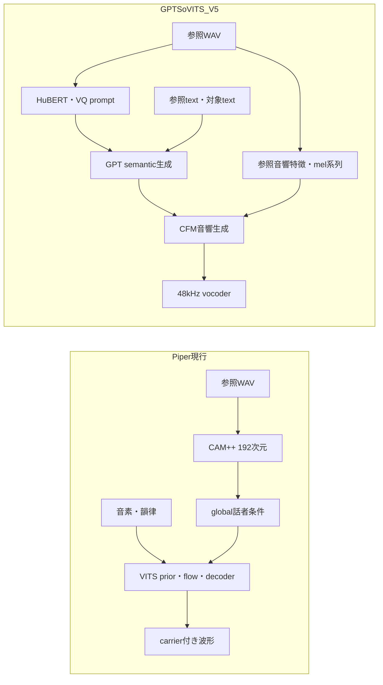

# GPT-SoVITS最新版からのzero-shot改善調査 — 2026-10-09

調査日: 2026-10-09 (JST)。対象: `feat/zero-shot-v8-dataset-scaling`、
`4b641dd4cd52e6cc3267178f87d22c436ec7b25a` (最新devリベース後)。
実施範囲: 公式資料・実コードの調査、保存済み学習ログの再解析、改善候補の反証レビュー。
新規合成・学習・GPUレンタル・モデル公開・品質承認は実施していない。

## 1. 判断に必要な結論

1. **最新モデル系列はV5 (`v5dev` / `v5turbo`)**。GitHubの最新正式releaseタグは
   `20250606v2pro`であり、タグ一覧だけを見るとV5を見落とす。
2. GPT-SoVITSから参考にすべき主な構造は、**参照音声の時間系列を音響生成へ渡すこと**。
   現行PiperはCAM++の単一192次元global embedding中心で、同じ情報を持たない。
   系列入力は既存設計のv12枠として別契約で試す。V5全体の移植は初手にしない。
3. 当面は **embedding入力・キャッシュの健全性、固定テスト音声の話者条件、
   予測F0での検証経路、EMAの対象範囲**を修正候補にする。既存構造のまま検証できる。
4. **v11bの「ep15相当で敵対rampを凍結」は、そのままでは対照実験にならない**。
   実設定とTensorBoardの両方でrampはep15から1.0。増えたのは損失値であり、
   係数のrampではない。F0のteacher forcing切替も交絡する。
5. 複数参照の平均＋L2正規化、Torch CAM++ SCL、CER、ONNX infer一本化は既実装。
   追加実装と既存機能の有効化・接続・検証を分ける。

## 2. 調査方法と確度

5エージェントで、(A) 上流version/構造、(B) 上流学習・推論、(C) ローカルmodel/training、
(D) ローカルpipeline/evaluation、(E) 独立反証レビューを分担。
統合担当はGitHub API、SHA固定のraw source、保存済みhparams/TensorBoardを独立照合した。

- **確認済み**: 指定SHAの実コード、API結果、ローカル保存ログから直接確認したこと。
- **公式報告**: 作者の比較値・設計説明。今回再現した値ではない。
- **仮説/提案**: Piperで効果が得られるか未測定。採否にはアブレーションが必要。

上流の初期調査SHA `e7cd61ec3dcc9a34089f50ed169e3103a16ad675` は最新mainより1commit古かった。
API compareで差分がWindows requirements 4ファイルへの`triton-windows`追加だけであることを確認し、
本書は最新SHAへ固定した。コード行番号はHTML表示の行数ではなくrawテキストで照合した。

## 3. 「最新ver」の確認

| 対象 | 確認結果 | 根拠 |
|---|---|---|
| 最新正式GitHub release | `20250606v2pro`、2025-06-06 03:04:27 UTC | [release](https://github.com/RVC-Boss/GPT-SoVITS/releases/tag/20250606v2pro)、[API](https://api.github.com/repos/RVC-Boss/GPT-SoVITS/releases/latest) |
| release tag commit | `d7c2210da8c013e81a94bfc7b811a477c99fd506` | [tag](https://github.com/RVC-Boss/GPT-SoVITS/tree/20250606v2pro) |
| 最新main | `1b47ca07ef43a284e0b8bd7f29d3e1e3ff76082a`、2026-10-08 16:27:04 UTC | [commit](https://github.com/RVC-Boss/GPT-SoVITS/commit/1b47ca07ef43a284e0b8bd7f29d3e1e3ff76082a)、[API](https://api.github.com/repos/RVC-Boss/GPT-SoVITS/commits/main) |
| main上の最新系列 | V5、`v5dev` / `v5turbo`。学習済み重みの案内あり | [README V5](https://github.com/RVC-Boss/GPT-SoVITS/blob/1b47ca07ef43a284e0b8bd7f29d3e1e3ff76082a/README.md#v5-release-notes)、[weights](https://huggingface.co/lj1995/GPT-SoVITS/tree/main/gsv-v5-pretrained) |

V2Pro/PlusはVITS系、V4/V5は拡散系。公式WikiではV5turboはdevのDMD蒸留版とされる。
実コードの既定値はdevが32step/CFG1.3、turboが4step/CFG0。
V5のfew-shot追加学習は公式説明でも未研究・未実験であり、最新だから追加学習まで成熟済みとは判断しない。
[公式version比較](https://github.com/RVC-Boss/GPT-SoVITS/wiki/GPT%E2%80%90SoVITS%E2%80%90features(Latest%E2%80%90Including%E2%80%90v5))、
[CFMV5 / synthesize_v5_mel](https://github.com/RVC-Boss/GPT-SoVITS/blob/1b47ca07ef43a284e0b8bd7f29d3e1e3ff76082a/GPT_SoVITS/module/models_v5.py#L16-L84)。

作者報告のSeedTTS中国語SIMはV4 .735、V2ProPlus .737、V5turbo(4step) .782、
V5dev .805、GT .755。これはprompt音声との比較であり、Piperのcross-utt/dual-encoder評価とは
互換でない。GT超過も自然さ・音質の証明ではない。日本語での優位は今回未検証。
[同Wikiの評価条件と限界](https://github.com/RVC-Boss/GPT-SoVITS/wiki/GPT%E2%80%90SoVITS%E2%80%90features(Latest%E2%80%90Including%E2%80%90v5)#3-seedtts-zeroshot-tts-eval-testset-cn)。

## 4. GPT-SoVITSから参考にするもの

### 4.1 global話者特徴と参照音響情報を分ける

**確認済み**: V2Pro系は参照spectrogramの`MelStyleEncoder`と、ERes2NetV2のSV特徴を併用する。
`sv_emb`射影入力は20480次元であり、CAM++192次元の代替として差し替えられない。
複数参照は各参照から得たconditioning `ge`を平均する。
[models.py:913 / 930 / 995](https://github.com/RVC-Boss/GPT-SoVITS/blob/1b47ca07ef43a284e0b8bd7f29d3e1e3ff76082a/GPT_SoVITS/module/models.py#L913-L1018)、
[sv.py](https://github.com/RVC-Boss/GPT-SoVITS/blob/1b47ca07ef43a284e0b8bd7f29d3e1e3ff76082a/GPT_SoVITS/sv.py)。

V5ではCN-HuBERT→VQのsemantic prompt、参照音響特徴、参照melが別に維持され、
target特徴と組み合わせてCFMへ渡される。V5にV2ProのSV追加があるとは言わない。
[semantic prompt抽出](https://github.com/RVC-Boss/GPT-SoVITS/blob/1b47ca07ef43a284e0b8bd7f29d3e1e3ff76082a/GPT_SoVITS/TTS_infer_pack/TTS.py#L907-L933)、
[参照特徴・melからV5音響生成へ](https://github.com/RVC-Boss/GPT-SoVITS/blob/1b47ca07ef43a284e0b8bd7f29d3e1e3ff76082a/GPT_SoVITS/TTS_infer_pack/TTS.py#L1745-L1772)。

**Piper側提案**: global CAM++を残し、別の参照音響系列を小さなencoderで固定K個のstyle tokenへ
圧縮し、enc_p/decoderへ注入する。これはV5の移植ではなく、その情報経路を参考にする新設計。
既存192次元ベクトルからK tokenを展開するだけでは情報は増えないため、同じ効果を期待しない。
入力schema・参照encoder・学習ペア作成・ONNX・各runtimeの変更が必要。
既存の[conditioning設計 §10](../design/zero-shot-v11-conditioning-design.md)と
[v11ロードマップ §4](../design/zero-shot-v11-roadmap.md)のv12枠で扱う。

### 4.2 参照音声の取り扱いと複数参照

**確認済み**: 上流semantic promptは16kHzで3〜10秒を要求する。
これは上流モデルの入力制約であって、Piperに同じ長さを強制する根拠ではない。
上流の振幅処理は大き過ぎる入力の抑制で、全入力を常にピーク1へ正規化する処理ではない。
[TTS.py:870-933](https://github.com/RVC-Boss/GPT-SoVITS/blob/1b47ca07ef43a284e0b8bd7f29d3e1e3ff76082a/GPT_SoVITS/TTS_infer_pack/TTS.py#L870-L933)。

Piperのmono化/16kHz resampleは[preprocess_audio](../../src/python/piper_train/extract_speaker_embedding.py)、
複数WAV平均＋L2正規化は同ファイル`extract_from_files`に既実装。
新規候補は単一音声のみの`infer_onnx --speaker-audio`への複数参照接続、
参照の有声時間・無音・clipping・異話者混入の検査と設定/hash記録。
初期A/Bでは品質重み付けを入れず、既存の等重み平均を基準とする。
過去の[話者類似根因調査 §3.3](../design/zero-shot-speaker-similarity-root-cause.md)には
20発話平均でも改善が小さい結果があるため、平均化を転写上限の解決策とは扱わない。

### 4.3 時間系列の参照を長文で維持する

**確認済み**: V5は参照上限500frame、総長上限1000frame、target chunk上限640frame。
2chunk目以降は元参照の一部と直前生成の32frame tailで条件付けを更新する。
実装の参考は「参照を保持しつつ直前文脈を少量残す」こと。
frame数をPiperの別hop/別sampling rateへそのまま移さない。
[models_v5.py:7-84](https://github.com/RVC-Boss/GPT-SoVITS/blob/1b47ca07ef43a284e0b8bd7f29d3e1e3ff76082a/GPT_SoVITS/module/models_v5.py)。

**仮説**: Piperでも長文の文境界に話者性・韻律の変動があるなら、v12の参照token固定と
前chunk文脈の保持が有効かもしれない。まず長文テストで症状を確認する。
SOLA/クロスフェードやlimiterは再生品質の別課題で、話者転写・carrierノイズ根治の代替にしない。

### 4.4 データの音声・テキスト整合を事前検査する

上流AR datasetはsemantic長とphoneme/秒を検査し、既定ratio範囲は3〜25。
[AR/data/dataset.py:146-170](https://github.com/RVC-Boss/GPT-SoVITS/blob/1b47ca07ef43a284e0b8bd7f29d3e1e3ff76082a/GPT_SoVITS/AR/data/dataset.py#L146-L170)。

**提案**: PiperでもASR transcript照合、phoneme/有声秒、極端な無音・切断を言語別に集計し、
既存の高域品質ゲートに足りないかを監査する。BOS/EOS/paddingや日本語韻律記号の数え方が違うため、
上流の閾値はコピーしない。offlineデータ監査として行い、評価器を学習中のlossや動的選別へ流用しない。

### 4.5 V5全体を初手で移植しない理由

HFの調査時点listingではV5 SoVITSは約766MB、vocoder約58MB、共通GPT約155MBで、
合計約980MB (配布ファイルサイズ、SSL/BERT等を除く)。これはparameter数や実行RAMとは別の値。
最新codeではV5専用vocoder重みを48kHzの`Generator`へロードする。
V3のBigVGANとV5のvocoderを同一視しない。
[HF listing](https://huggingface.co/lj1995/GPT-SoVITS/tree/main)、
[TTS.py:726-755](https://github.com/RVC-Boss/GPT-SoVITS/blob/1b47ca07ef43a284e0b8bd7f29d3e1e3ff76082a/GPT_SoVITS/TTS_infer_pack/TTS.py#L726-L755)。

4step化/CUDA Graph/FlashAttentionの高速性が、Windows CPU/ONNXでそのまま成立するとは確認できない。
公式[onnx_export.py](https://github.com/RVC-Boss/GPT-SoVITS/blob/1b47ca07ef43a284e0b8bd7f29d3e1e3ff76082a/GPT_SoVITS/onnx_export.py)と
[v3/v4 TorchScript exporter](https://github.com/RVC-Boss/GPT-SoVITS/blob/1b47ca07ef43a284e0b8bd7f29d3e1e3ff76082a/GPT_SoVITS/export_torch_script_v3v4.py)を確認した範囲で、
V5専用ONNX経路は確認できなかった。「ONNX化不能」という断定ではない。
現行Piperの`[1,192]`入力、FP16≤40MB、CPU p50増加≤10%は
[v11の設計ゲート](../design/zero-shot-v11-roadmap.md)であり、V5配布物には適用不能。

## 5. 現コードからの具体的な改善候補

### C1. embeddingの検証とキャッシュの同一性 (P0、再学習不要)

**確認済み**: `extract_speaker_embedding.py:531-559`は既存`.npy`のstemだけでcache hitにする。
元音声・encoder・chunk設定の変更や破損を区別できない。
`speaker_embedding_path`を処理成功前に設定し、部分失敗や抽出対象なしの早期return
(`:583-588`)で存在しないpathがJSONLへ残り得る。全失敗を止めるguardだけでは覆えない。
テスト`test_extract_speaker_embedding.py:347-369`にも空ファイルをcache hitにするfixtureがある。

**提案**: 音声hash、encoder hash/family、fbank/resample/chunk版、shape/dtype/finite/normをmanifestに記録。
保存成功後にpathを確定し、失敗entryの扱いを明示。破損/別設定のcacheは再計算する。
検証は空npy、NaN、別encoder、欠損音声、成功と失敗の混在、stem衝突のfixtureで行う。
出典: [抽出処理](../../src/python/piper_train/extract_speaker_embedding.py)、
[datasetのnp.load](../../src/python/piper_train/vits/dataset.py)。

**確認済み**: `.npy`入力は`infer_onnx.py:459-474`でshapeのみ、HTTP入力は
`http_server.py:169-194`で次元のみを検査し、`voice.py:1114-1116`はそのままfeedする。
抽出側とtraining側のL2正規化に対して、入力境界でfinite/normの契約が弱い。
ゼロベクトルにはmask=0/default経路という既存用途があるため、全経路一律に禁止しない。
明示的なzero-shot入力(mask=1)のNaN/Inf/zero normを拒否し、norm逸脱は互換方針を決めて
警告または正規化する。モデルgraphに無断で正規化を足すより入力境界から着手する。
出典: [推論CLI](../../src/python/piper_train/infer_onnx.py)、
[HTTP](../../src/python_run/piper_plus/http_server.py)、[voice](../../src/python_run/piper_plus/voice.py)。

ECAPA256次元APIも存在するが、現zero-shot CLIの音声経路はCAM++。
「全runtimeがECAPAを誤入力している」は未確認。family/hashを識別し、同じ次元でも
違うencoder空間を混ぜない改善として扱う。
[ECAPA API](../../src/python/piper_train/speaker_encoder/encoder.py)。

### C2. 固定テスト音声に話者条件を渡す (P0、監視の修正)

**確認済み**: `lightning.py:867-876`の`_load_test_dataset`はembeddingを読み込まない。
`on_validation_epoch_end`の`:2547-2565`はembeddingが無いmulti-speaker音声をゼロで生成する。
この固定テスト音声は参照話者のzero-shot品質を示さない。
[lightning.py](../../src/python/piper_train/vits/lightning.py)。

**提案**: 固定test manifestの参照embedding/pathを読み、encoder情報も記録。
ゼロ条件の汎用サンプルと参照話者評価を表示上も分ける。inferへ渡るembeddingをassertするテストを追加。
外部v11評価driverは別にCAM++参照を使うため、この指摘だけで過去のSECS/CERを無効とはしない。

### C3. 予測F0だけの検証を別に設ける (P0、検証経路の修正)

**確認済み**: `validation_step` (`lightning.py:2473-2487`)は`training_step_g`を再利用。
同じteacher forcing確率を使い、`models.py:1665-1682`はeval時もGT/予測F0をBernoulli混合する。
v11設定では最終的にも50%のサンプルがGT F0を使い、実推論の100%予測F0と違う。
これはvalidation再構成経路の問題であり、既存のexternal `model_g.infer`評価とは区別する。
[F0経路](../../src/python/piper_train/vits/models.py)、[training/validation](../../src/python/piper_train/vits/lightning.py)。

**提案**: 従来reconstruction validationを残し、予測F0のみのvalidationを別名で追加。
F0混合部分のテストではRNGを固定し、GT F0を変えても予測専用経路が変わらないことを検証する。
VITSのz/SDP/carrier noiseも確率的なので、モデル全体が無条件に決定的になるとは主張しない。
本学習の`p_max=.5→1.0`は新しい変更であり、切替を遅らせる案も含めて独立A/Bを行う。

### C4. F0系を含むEMAの整合性 (P1、新scopeと互換処理が必要)

**確認済み**: `ema.py:18`のextended対象は`flow / enc_p / spk_proj_dp`。
`models.py:1429-1452`の`f0_predictor / spk_proj_f0 / f0_prior_res`は対象外。
EMA適用時に、平均化されたdecoder/priorとrawのF0経路を組み合わせる。
[EMA](../../src/python/piper_train/vits/ema.py)、[F0 modules](../../src/python/piper_train/vits/models.py)。

**仮説**: carrierがF0軌跡へ敏感なため、この混合が品質差を作る可能性。
過去の早期checkpointでEMAが悪かった事実から、今回の漏れがその原因だったとは言えない。
新しいEMA scopeでF0関連を条件付きで登録し、checkpoint migration・export側適用範囲も揃える。
raw / 現extended / F0込みの3条件を同じstep・seedで比較。常にEMAを採る変更にはしない。

### C5. 学習設定が実際に要求したSCLへ到達するか検証 (P1、設定guard)

Torch CAM++ SCLは既実装。ONNX fallback (`lightning.py:2145-2168`)は明記どおり勾配ゼロの監視用。
encoderなしのmel fallbackは話者identity lossではない。v11保存レシピはTorch CAM++を指定しており、
「v11はONNX SCLで学習できなかった」という原因説は棄却する。
[CLI](../../src/python/piper_train/__main__.py)、[SCL](../../src/python/piper_train/vits/lightning.py)。

一方、`cross_utt`指定でもspeaker IDsなしなら警告後same_uttへ変更 (`:2101-2111`)。
`losses.py:167-190`では別発話positiveが無ければsame-utt CEへfallbackする。
strictなzero-shotレシピで実際のpositive数/fallback回数を記録し、設定不備は開始前に止める。
`samples_per_speaker>=2`だけではDDP/実batchの成立を証明しないため、実batchも検査する。
v11は4samples/speakerを指定済みなので、これも過去runの原因と断定しない。
[losses.py](../../src/python/piper_train/vits/losses.py)。

### C6. 参照抽出と短い学習cropの分布差 (P1、アブレーション)

**確認済み**: training参照embeddingは既定400frame/50% overlapのchunk平均
(`extract_speaker_embedding.py:307 / 655-689 / 871`)。
単一WAV推論抽出は全fbankを1回処理 (`:56-149`)。音声が長いほど差が生じ得る。
SCLの生成音声はdecoderのsegment。既定8192samples=約0.37秒、**v11は16384=約0.74秒**。
参照側4秒と生成側の短いcropは同じ条件ではない。
[抽出](../../src/python/piper_train/extract_speaker_embedding.py)、
[generator slice](../../src/python/piper_train/vits/models.py)、[SCL再forward](../../src/python/piper_train/vits/lightning.py)。

**提案**: まず同じ参照の全長抽出/4秒chunk平均を比較し、推論抽出を共通関数へ寄せる。
学習側は長い連続cropまたは複数cropのSCLを独立に試す。
短い音声を反復して4秒にしても情報は増えない。VRAM/step時間を測り、単純に4秒へ一括拡大しない。
これで話者類似が改善することは未検証。

### C7. CER評価集合とheld-out話者を固定する (P0/P1、評価の完全性)

`eval_cer.py:146-161`は参照textのないWAVをskipし、text側にある未生成WAVを列挙しない。
model/language/text集合/hash/seedを固定する契約はあるが、現ツールJSONはその完全性を強制しない。
strict modeで期待IDと生成IDの一致、重複、最低clip数、ASR revision、wav/text hashを記録し、
部分生成でも良いmedianに見える穴を閉じる。
[eval_cer](../../src/python/piper_train/tools/eval_cer.py)、[評価契約 §7](../spec/zs-eval-contract.md)。

`lightning.py:914-954`の標準splitはutterance-level random split。
これはseen-speaker reconstruction監視として残せるが、unseen-speakerの証拠にはしない。
外部v11 driverは別`holdout/dataset-holdout.jsonl`を使う。
今回は実dataset全manifestが揃っていないため、**過去v11に話者リークがあったとは未確認**。
学習/holdout話者IDと音声hashの交差ゼロを事前検査するartifactを追加する。

### C8. 欠損embeddingと確率的carrierの扱いを明示 (P1)

`dataset.py:646-661`は一部欠損embeddingをゼロ埋めし、speaker IDを保持する。
zero-shotレシピでは欠損率を事前監査し、欠損を黙って正常な参照条件として学習させない。
全サンプルが欠損する場合は別のfallbackがあるため、混在条件をテストする。

`mb_istft.py:1103-1110`はcarrier noise未指定時に`randn_like`を生成する。
`noise_scale=0`だけでは全出力の決定性を保証しない。
Torch/ONNX比較ではlatent/SDP/carrierの乱数を固定または外から指定する診断wrapperを使い、
確率的枝をバグと混同しない。音響品質比較は固定seed群・raw出力で行う。
[dataset](../../src/python/piper_train/vits/dataset.py)、[carrier](../../src/python/piper_train/vits/mb_istft.py)。

## 6. v11学習崩壊の再解析: ramp仮説の修正

### 保存物と確認方法

ローカル`piper-v11-local/box-evac/box-final-evac.tar.gz`を展開せずメモリ上で読み、
version_0/version_1のhparams、評価chain log、version_0 TensorBoard scalarを照合した。
archive hash、内部member名、epochごとのmedian/countは
[再解析JSON](gpt-sovits-zero-shot-2026-10-09-v11-events.json)に保存。
TensorBoardはTFRecord framingを読みEvent protobufでparseし、同じstepのepochとscalarを結合。
CRCは再検証していない。数値は保存ログの再集計で、新規の学習実験ではない。

両hparams: `adv_spk_start_epoch=10`、`adv_spk_ramp_epochs=5`、`c_adv_spk=.5`、
`f0_teacher_forcing_epochs=10`、`f0_teacher_forcing_ramp=10`、`f0_pred_prob_max=.5`。
`c_spk=.066607`、`scl_detach_z=true`、`use_carrier_head=true`。
epochはLightningの0-based記録をそのまま使用する。

| epoch | adv ramp | 重み適用後loss_adv_spk median | 予測F0確率 | loss_mel median |
|---|---:|---:|---:|---:|
| 9 | 未log (inactive) | 未log | 0 | 28.7576 |
| 11 | .2 | 1.7491 | .05 | 28.6887 |
| 15 | 1 | 9.0535 | .25 | 29.9060 |
| 19 | 1 | 10.8805 | .45 | 31.1217 |
| 20 | 1 | 10.3955 | .50 | 31.0701 |
| 25 | 1 | 11.0630 | .50 | 30.2319 |
| 26 | 1 | 12.5934 | .50 | 30.6322 |

`losses.py:296-310`のramp式と一致する。評価chain logはep25/29で
ECAPA .1483/.2314、過去best .3866に対するR3停止を記録している。
R3の観測事実は維持する。

### 言えること / 言えないこと

**確認済み**: ep19以降にramp係数は増えていない。F0切替はep20まで進んだ。
敵対損失の値は上限到達後も大きくなった。
**仮説**: 分類器との競合、F0予測誤差への適応、短いSCL crop、その他の損失バランスが崩壊に関与。
損失値の増大はgradient圧力の増大を直接証明しない。
SCLを含むどの経路がECAPA低下を起こしたかは、この観測データだけでは一意に決まらない。

既存[roadmap §5](../design/zero-shot-v11-roadmap.md)の原因帰属は仮説として読み替える。
「ep15相当でrampを凍結」は実際の上限1.0と同じなので、v11b前に具体的な別設定へ改訂する必要がある。
本調査では過去のcanonical記録自体を書き換えず、反証と次実験の条件をここに残す。

## 7. 実装・実験の推奨順

| 順 | 作業 | 見込み/目的 | 学習 | 成立条件 |
|---|---|---|---|---|
| 1 | C1/C2/C3/C7: cache/入力/固定参照/予測F0検証/CER集合 | 壊れた条件・不完全な監視を排除 | 不要 | 再現fixtureで失敗→修正後pass、legacy/default経路の互換 |
| 2 | C5/C8: SCL設定と欠損/乱数の可視化 | 実際に選んだ学習・評価経路を確認 | 小規模smokeのみ | positive数、fallback、module別grad、artifact hashを記録 |
| 3 | C6: 同じCAM++前処理/複数参照接続 | 現契約内で試せる低コストbaseline | 推論A/B部分は学習不要 | conditioning全参照をcross評価から除外、同encoder・同総有声時間 |
| 4 | C4: F0関連EMAの新scope | checkpoint内部の経路整合を比較 | 有効なEMA蓄積が必要 | raw/extended/new scope同条件比較、migration/export一致 |
| 5 | v11b安定化の原因分離 | 明瞭度とcarrier音質の両立 | 必要 | 以下の単一変数arm、R3継続、閾値据置 |
| 6 | v12: 実参照系列→K style tokens | global vector以外の音色情報を増やす | 必要 | 新契約/サイズ/CPU予算を事前登録、global-only対照 |

v11bは全変更を一度に入れて80epochを再実行しない。最小の分離実験案:

- **対照**: v11と同じrecipe/データ/seed。実係数・F0確率・loss勾配を記録。
- **arm A**: adversarial speaker classifierだけoffまたは事前に固定した低い`c_adv_spk`。
  F0 scheduleは同じ。offと低係数の両方を1armに混ぜない。
- **arm B**: F0予測切替だけ遅延。adversarial設定は対照のまま。
  GT F0で良くなっても実用判定は常に予測F0 inferで行う。
- **arm C (後段)**: `p_max=1.0`への切替を試す。初期から急に増やす案と同時比較しない。

短期smokeはgradient/崩壊経路の診断であり、早期CER不合格だけで停止しない。
旧ep19からのwarm resumeは診断用途に限定し、改善の最終判定は公平なfrom-scratch条件で行う。
GPU費用/期間は今回測定していない。過去費用を最新の確定見積として使わない。

## 8. 評価と採否

[zs-eval-contract](../spec/zs-eval-contract.md)を維持する。
cross-utt SECS (CAM++/held-out ECAPA)、ceiling/floor/正規化転写率、same/cross gap、
raw comb/band/comb-HNR、F0記述統計、CER、実際の日本語聴取、サイズ/CPU p50/初回遅延を別々に報告。
ECAPA・評価音響統計を学習loss/reward/動的選別へ組み込まない。
モデルの良否を後段EQ/denoise/limiterの出力で判定しない。

CER median≤.30、whisper-small、固定≥3文、ep40以降の昇格判定は既登録のまま。
話者・文・参照条件を広げる追加評価は別名で記録し、既存3文の閾値へ混ぜない。
複数参照ではconditioningに使った**全WAVのpath/hash**をcross集合から除外する。
同じ参照数でも総有声時間が違うと比較が交絡するため、総時間も統制する。

既存40MB/+10%ゲートは現契約内の候補に適用。
v12で予算を変える場合は新契約として先に決め、旧gateの事後緩和として扱わない。
qualityの承認にはABX/自然さ/読みの確認を残し、SIMやCERだけで公開判断しない。

## 9. 今回棄却・保留した提案

- モノラル化/16kHz化/複数参照平均/seed固定/話速scalesを「全部未実装」とする: 既存機能と重複。
- ONNX SCLの勾配ゼロをv11崩壊原因とする: v11はTorch CAM++経路を使用。
- `ep15でramp固定`だけで崩壊を直す: 実runが既に同じ係数。
- ECAPA256やERes2Net特徴をCAM++192へ差し替える: 次元・encoder空間・学習分布が違う。
- same_utt/作者のCN SIMだけで採用する: cross-utt/dual-encoder/日本語聴感の証拠にならない。
- V5のsampling/top-k/CFGを現VITSへ直接追加する: 対象の生成モデルが違う。
- peak normalization/クロスフェードでcarrierの音色問題を解決する: 根因への証拠なし。
- 参照vector→learned K tokensだけで参照系列の利得を再現する: 新情報がなく、効果未実証。
- 既存trainingのrandom_splitだけからv11外部holdoutのリークを断定する: 実manifest未照合。

## 10. 残る未知点と次の確認

1. 同じCAM++の全長抽出/chunk平均の差は対象話者でどの程度か。encoderと参照hashを固定して測る。
2. v11の崩壊前後で、敵対/SCL/mel/F0のmodule別gradient比はどう変わるか。保存logに十分なprobeなし。
3. F0込みEMAはrawより良いか。新scopeを用意した同条件学習が必要。
4. 実datasetのtrain/holdout話者・WAV hash交差と参照の異話者混入はないか。manifest回収後に確認。
5. V5turboが同じ日本語・同じ参照でどれだけ良いか。比較合成・人手試聴は今回未実施。
6. K-token入力で現行軽量化目標を守れるか。parameter/ONNX/CPU実測前に利得や速度を保証しない。

主な取得コマンド: GitHub `releases/latest` / `commits/main` / `compare` API、
`urllib.request`でSHA固定raw取得、`rg -n`でローカル配線確認、`tarfile`でhparams/log読取、
`tensorboard.compat.proto.event_pb2.Event`で保存scalar再集計。
外部モデル重みはダウンロードしていない。再解析JSONは参照元archive SHA256を含む。

## 11. 調査結果の検証

- ローカル相対リンクの存在、JSON parse、version_0/1の対象hparams一致、
  ep15/19/20/25/26のramp=1.0、ep19 F0確率=.45/ep20=.5を確認。
- SHA固定の上流raw sourceで行番号とexporter存在を確認。HF公開APIでV5重みサイズを照合。
- CPUで現コードの関数をASTからそのまま読み込む小さなprobeを実行。
  `np.load`だけを192次元NaN配列へ差し替えた`_resolve_speaker_embedding`はNaNを受け入れた。
  `_f0_for_decoder`は`training=False`、GT=1、予測=2、確率=.5、64sample、seed1234で
  出力に1と2を含んだ。前者は入力検証の欠落、後者はevalでもGT混合する経路の確認。
  完全なmodel/checkpointの合成実験ではなく、音質改善量は測っていない。
- 独立反証レビューで、既実装の重複、実runとCLI既定値の混同、未立証のencoder mismatch、
  causal attributionを除外。推奨順表の学習要否も本文と照合した。
